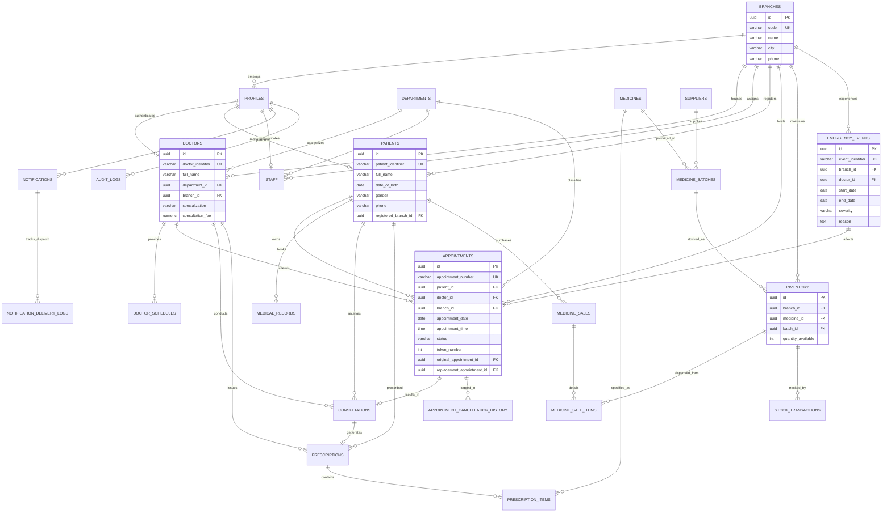

# MedTrack Multi-Branch Hospital: Entity-Relationship (ER) Documentation

## 1. Architectural ER Diagram (Mermaid)

## 2. Cardinality & Relationship Matrix

| Relationship | Entities Involved | Cardinality | Business Logic & Integrity Constraints |
|---|---|---|---|
| **Branch Allocation** | `branches` -> `doctors` | 1 : N | Each doctor belongs to one hospital branch. A branch contains many specialized doctors. |
| **Branch Scheduling** | `doctors` -> `doctor_schedules` | 1 : N | A doctor specifies active consultation slots per weekday. |
| **Clinical Consultation** | `patients` -> `appointments` | 1 : N | A patient can reserve multiple appointments across clinic history. |
| **Concurrency Lock** | `appointments` (`doctor_id`, `date`, `time`) | Unique Constraint | Partial unique index guarantees no overlapping active bookings for the same doctor slot. |
| **Emergency Replacement** | `appointments` -> `appointments` | 1 : 1 (Recursive) | `original_appointment_id` and `replacement_appointment_id` link auto-rescheduled events. |
| **Pharmacy Stock** | `branches` x `medicines` x `batches` -> `inventory` | N : M | Composite uniqueness (`branch_id`, `medicine_id`, `batch_id`) with non-negative stock constraint. |
| **Prescription Items** | `prescriptions` -> `prescription_items` | 1 : N | Each prescription contains one or more medicine dosage lines. |
